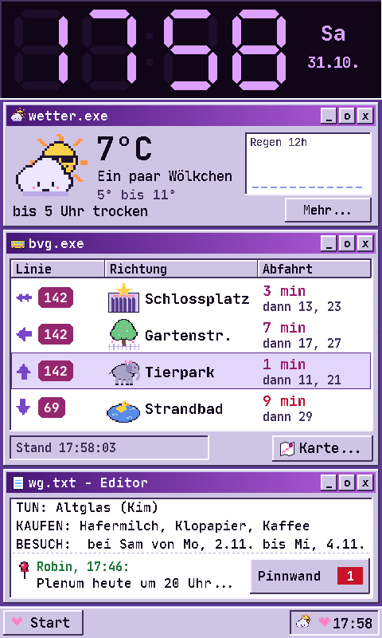
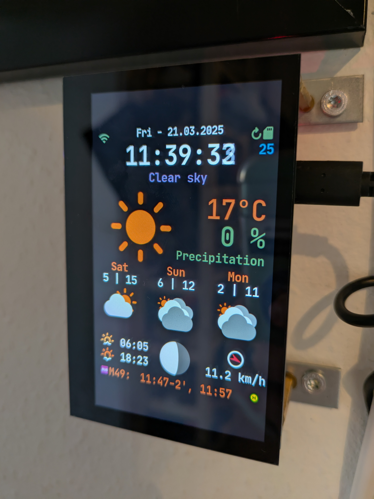
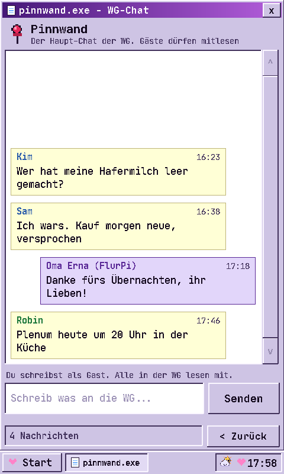
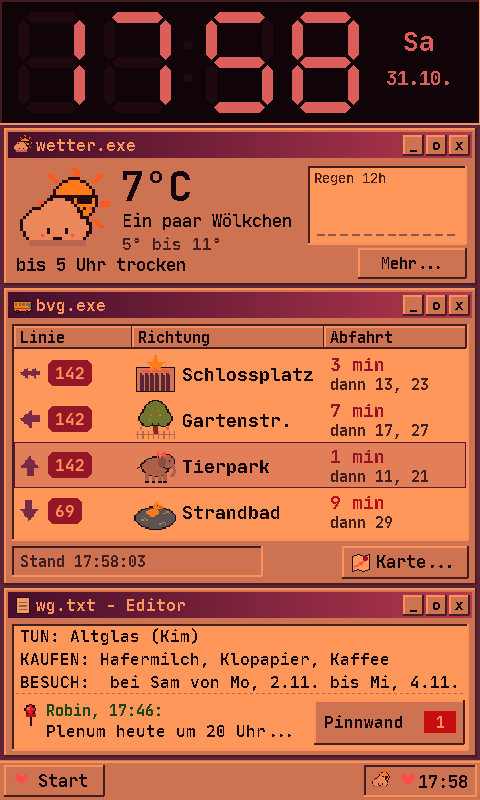
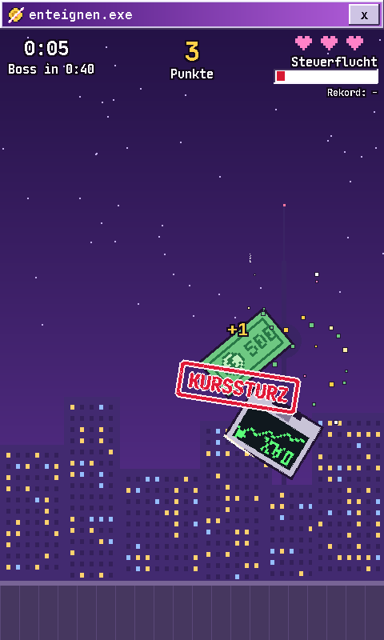
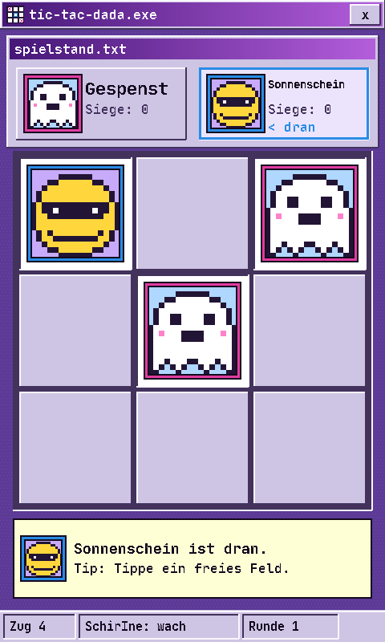
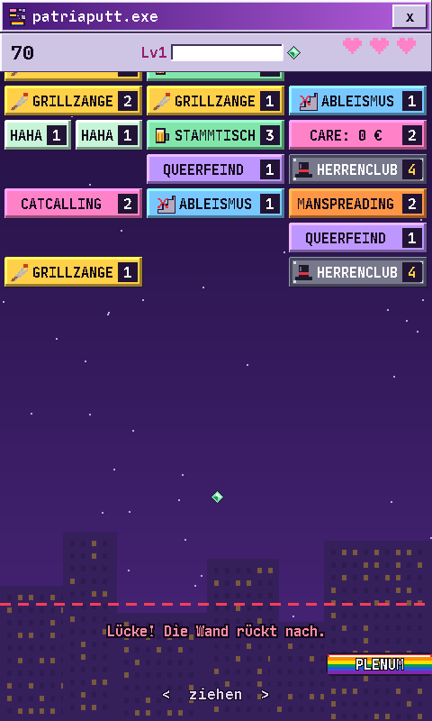
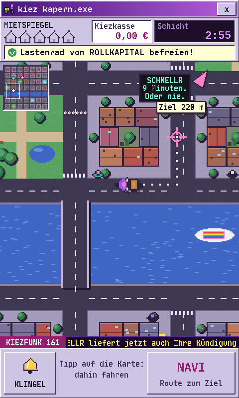
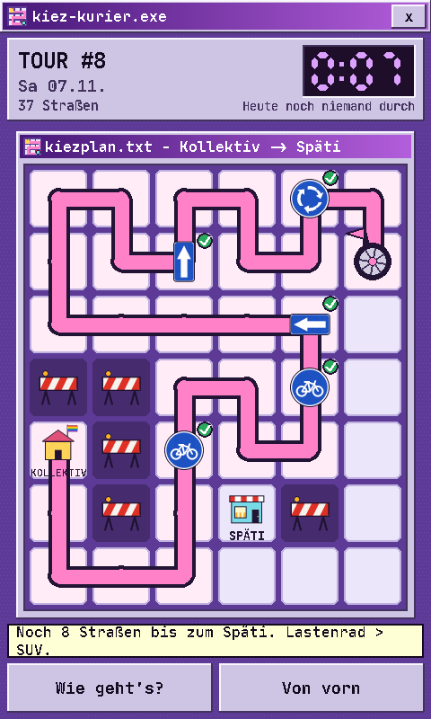
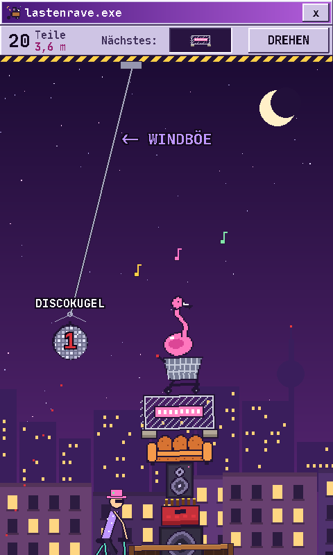

> **Disclaimer**
> This dashboard, run on a Raspberry Pi and displayed on a small TFT display, is heavily inspired by [WeatherPi_TFT](https://github.com/LoveBootCaptain/WeatherPi_TFT) and [BusStopPi](https://github.com/LoveBootCaptain/BusStopPi), so most of the props go to [LoveBootCaptain](https://github.com/LoveBootCaptain) (Stephan Ansorge)! Especially the [WeatherPi_TFT](https://github.com/LoveBootCaptain/WeatherPi_TFT) repository is more general and contains information and manuals about many more displays and settings. Check it out if you do not want to rebuild my exact setup as described below, which works perfectly as of March 2025.
> Since the KiezOS 161 redesign (October 2026), the look is completely its own (a purple, quirky, old-school desktop OS with self-drawn pixel icons), but the weather/BVG plumbing underneath still comes from there.

# KiezOS 161 - a low-resource, efficient Dashboard to ease your daily life - Weather, Public Transport (in Berlin), and Emotion Log for your 'smart' WG

## Preview

| Home screen (made-up stops and flatmates)                                  | Wall installation (older UI)                                                              |
| -------------------------------------------------------------------------- | ----------------------------------------------------------------------------------------- |
|  |  |

| pinnwand.exe (WG chat for guests)                                    | Night mode                                                          | ENTEIGNEN!                                                        |
| -------------------------------------------------------------------- | ------------------------------------------------------------------- | ----------------------------------------------------------------- |
|  |     |  |

| TIC-TAC-DADA                                                            | PATRIAPUTT                                                            | KIEZ KAPERN                                                         |
| ----------------------------------------------------------------------- | ------------------------------------------------------------------------ | ------------------------------------------------------------------- |
|    |  |  |

| KIEZ-KURIER (daily puzzle)                                              | LASTENRAVE                                                               |
| ----------------------------------------------------------------------- | ------------------------------------------------------------------------ |
|     |       |

## Abstract
In here, I explain (for my future me and anyone else reading this, feel free to share!) how to successfully set up on a Pi 4B with the Waveshare 4,3 Zoll QLED Touch Display (DSI, 800x480) and Pi OS 20241119 (bookworm).

## Problem Setting
The classic issue: you're living in Berlin, juggling a dozen things at once, and checking the bus times for the stop right outside your door is the last thing on your mind. That’s exactly where this dashboard comes in. It shows you live info for your nearby bus or train stop (you can pick any line or station you want), plus real-time weather data. Basically, the stuff you’re probably already checking on your phone every day, but now it’s just there. Stick it in your hallway and make life easier for you and your flatmates. It can also support emotional awareness: lightweight emotional logging creates a simple reflection trail that helps you and your flatmates spot mood patterns over time.

## What's on the screen
The 480x800 screen is dressed up as *KiezOS 161*, a purple 90s desktop, ordered by what you look at first when you walk by:
- `uhr.exe`: a big 7-segment clock with a blinking colon.
- `wetter.exe`: current weather, today's low/high and whether rain is coming in the next 12 hours (hourly forecast from [Open-Meteo](https://open-meteo.com/), no API key needed). `Mehr...` opens the details: feels-like, humidity, wind, UV, the rain chart, sunrise/sunset, moon phase and the next 3 days.
- `bvg.exe`: one row per configured bus connection with its destination landmark, "in x min" plus the departures after it, and delays in red. `Karte...` draws the same connections on a little map of the Kiez.
- `wg.txt`: what's due, what to buy and who's visiting, plus a strip that opens `pinnwand.exe`, the WG's chat, where guests can read along and leave a message (optional MoaBeats integration, see below).
- The `Start` menu bundles everything else: Spiele (a game of the day, a few favourites and a folder with the rest), AFM-Quiz, Putzdienste, WLAN-Zugang, Stimmung & Stats and `Herunterfahren...` (try it).
- At night the whole screen turns warm red, so it doesn't light up the hallway (optional).
- Some surprises when you walk past. Not telling.

## Cost estimate
As of March 2025, the Raspberry Pi 4B that I am using costs ~40€ and the display is ~35€. My mount on the wall is very experimental and cost me less than 5€. If you add the optional HC-SR505 PIR motion sensor, that's another ~2€.
Assuming a power consumption of the Pi alone of about ~3W (the Pi is mostly idling, but lets be ballpark here. What I should do: Measure the actual consumption with a multimeter) and a consumption of the
display of ~1.2W when it's on (I am not sure about numbers for when it's idling and simply reacting to touch - again, one multimeter would solve all these questions), the operational cost is
0.0042 kW x 24 h/day × 365 days = 36.79 kWh, so ~15€ a year (assuming 40ct/kWh).

## Hardware

### Setup your Pi

- Install OS to an SD card: Easiest with Raspberry Pi Imager.
- Beware about how you want to connect to/set up the Pi; see [this tutorial](https://www.tomshardware.com/reviews/raspberry-pi-headless-setup-how-to,6028.html) for a headless setup without ever having to use a monitor (TL;DR: you can change a config file on the SD card such that the Pi automatically connects to your WiFi network, so you can do everything about/with it via SSH from the start)
- Go through config stuff: [raspi-config](https://www.raspberrypi.org/documentation/configuration/raspi-config.md)
- Update all tools: `sudo apt-get update -y && sudo apt-get upgrade -y`

### Set up the Display

- Luckily, with the Waveshare 4,3 Zoll QLED Touch Display, that we are using, everything works out of the box.
- When you mounted your system, you might need to rotate it properly with the Pi Screen Configuration setting in the OS directly (and potentially manually rotate the touch via a `40-libinput.conf` file), see [this tutorial](https://www.waveshare.com/wiki/4.3inch_DSI_QLED )

### Optional: HC-SR505 PIR Motion Sensor

To enable the display to wake on motion detection (instead of touch only):

**Wiring** (HC-SR505 has 3 pins):
- VCC (+) → Pin 2 (5V)
- GND (-) → Pin 6 (Ground)
- OUT → Pin 11 (GPIO17)

**Setup**:
```bash
pip install RPi.GPIO
```

**Configuration** in your `config.json`:
```json
"PIR_SENSOR": {
    "ENABLED": true,
    "GPIO_PIN": 17
}
```

**Test** before running the dashboard:
```bash
python3 dev/test_pir_sensor.py
```

The HC-SR505 Mini has a fixed ~8 second trigger time and no adjustment potentiometers. The dashboard handles debouncing automatically.

If `CLEANING_DAY` is active, PIR motion wake is ignored for that day so the cleaning reminder stays visible when people walk by. Touch wake still works.

## Software

### Install dependencies
Here, it could get a bit tricky as I do not remember precisely anymore if everything worked flawless, but I can assure you that you will get it to work with five minutes of your time and maybe some help by a quick web search.

For [*pygame*](https://www.pygame.org/wiki/CompileUbuntu):
```bash
sudo apt-get install git python3-dev python3-setuptools python3-numpy python3-opengl \
    libsdl-image1.2-dev libsdl-mixer1.2-dev libsdl-ttf2.0-dev libsmpeg-dev \
    libsdl1.2-dev libportmidi-dev libswscale-dev libavformat-dev libavcodec-dev \
    libtiff5-dev libx11-6 libx11-dev fluid-soundfont-gm timgm6mb-soundfont \
    xfonts-base xfonts-100dpi xfonts-75dpi fontconfig fonts-freefont-ttf libfreetype6-dev
```
If you experience `sdl-config command not found`, see [this post](https://stackoverflow.com/questions/19579528/pygame-installation-sdl-config-command-not-found) and consider adding `python-numpy subversion ffmpeg` to the above list.

### Install PiDashboard

- Clone: `git clone https://github.com/MassEast/pi_dashboard.git && cd pi_dashboard`
- Set up venv: `python3 -m venv venv`
- Install requirements: `source venv/bin/activate && sudo pip3 install -r requirements.txt`

### Create a RAM disk to protect your SD card

The PiDashboard will write a json file to your Pi after updating the weather data from the API provider.
This process will reduce writing to your SD card, cause we're writing it only to RAM.
*ramdisk* will only be used in production mode, i.e., you have set your `"ENV"` in your config.json file to `"Pi"`.
To run things locally on my Laptop, I use the "STAGE" environement.

Run
```bash
sudo mkdir /mnt/ramdisk
sudo nano /etc/fstab
```
and add the following line right at the end of the opened file (`size=5M` specifies the size of the reserved ram (5M is more than enough)):
```bash
tmpfs /mnt/ramdisk tmpfs nodev,nosuid,size=5M 0 0
```

Finally mount the RAM disk and reboot your Pi:
```bash
sudo mount -a
sudo reboot
```

`/mnt/ramdisk` is RAM-backed, non-persistent storage: all files there are lost after reboot or power loss.

If you want to log a lot to files (`"LOG_TO_FILES"` set to `"true"`), you may also consider writing all logs to RAM and only write to the SD card daily, see @azlux: [log2ram](https://github.com/azlux/log2ram).

If you want uptime statistics, enable `"LOG_UPTIME"` in `config.json`. This writes a persistent `logs/uptime.json` file with screen, reboot, network, BVG, and weather transitions so the web dashboard can derive summary stats.

### Screen blanking

To make your screen blank out in black after some time (which saves energy), you need to uninstall `xscreensaver` by running `sudo apt-get remove xscreensaver` and enable screen blanking in the `sudo raspi-config` settings.

### Dashboard Configuration

To create an empty config file, run
```bash
cp example.config.json config.json
```
and edit it using, e.g., `nano config.json`.

#### Display options
Our display is 800x480, mounted in portrait, so the dashboard runs at 480x800 (`WIDTH` 480, `HEIGHT` 800, the defaults in the example config file). KiezOS 161 is drawn for exactly that size.
Further options explained:
- `FPS` is used for pygame internal ticks - 20 fps is plenty for the blinking clock and scrolling text
- `SHOW_FPS`: show the current fps on the display
- `MOUSE` enable/disable mouse pointer - needed for local development, better leave it disabled

#### weatherbit.io settings
- Replace `xxxxxxxxxxxxxxxxxxxxxxxxx` in  `"WEATHERBIT_IO_KEY": "xxxxxxxxxxxxxxxxxxxxxxxxx"` with your own API key. You can get this key from [weatherbit.io](https://www.weatherbit.io/). You need to register.
- Replace `en` in `"WEATHERBIT_LANGUAGE": "en"` with your preferred language
- Replace `de` in `"WEATHERBIT_COUNTRY": "de"` with your country
- Replace `14057` in `"WEATHERBIT_POSTALCODE": 14057` with your zip code / postal code (this example-location zip code
is from berlin city, germany)
- For language-support, units, etc please refer to -> **[weatherbit API Docs](https://www.weatherbit.io/api)**

#### Rain forecast (Open-Meteo)
Weatherbit's free tier has no hourly forecast within its 50 calls/day, so the "rain coming?" line
and the 12-hour rain chart come from [Open-Meteo](https://open-meteo.com/)'s hourly
`precipitation_probability` instead: free, no API key, queried for the location Weatherbit reports.
(Side note: `WEATHERBIT_HOURS` in `config.json` is dead config — loaded but never used anywhere.)

#### Hardcoded localise strings and ISO settings
```json
  "LOCALE": {
    "ISO": "en_GB",
    "RAIN_STR": "Rain",
    "SNOW_STR": "Snow",
    "PRECIP_STR": "Precipitation",
    "METRIC": true
  }
```
- Change `"ISO"` and `"METRIC"` according to your needs
- `"METRIC": true` will get all weather data units as metric system, change to `false` if you prefer imperial styled units. Then `°C` will be `°F` and `km/h` will be `mph. This also affects the weatherbit API request via its `units` parameter.

#### Settings for BVG (public transport in Berlin)
```json
  "BVG": {
    "ROWS": [
      {
        "id": "row-one",
        "departure_id": "XXXXXXXXX",
        "direction_id": "YYYYYYYYY",
        "line": "ABC",
        "icon": "left",
        "label": "Schlossplatz",
        "landmark": "palace"
      },
      {
        "id": "row-two",
        "departure_id": "XXXXXXXXX",
        "direction_id": "ZZZZZZZZZ",
        "line": "ABC",
        "icon": "right",
        "label": "Gartenstr.",
        "landmark": "garden"
      }
    ],
    "LOOKAHEAD_MIN": 30,
    "LOOKBACK_MIN": 5,
    "MAP": {"WATER": [...], "STREETS": [...], "BRIDGES": [...], "ROUTES": [...],
            "LANDMARKS": [...], "HOME": {...}, "STOPS": [...]}
  }
```
Each entry in `ROWS` is its own dashboard row - not limited to one stop with a left and a right
direction, so you can mix different stops, lines, and directions freely, one row per bus
connection you actually want to see:
- `id`: any unique string you pick, just used internally to match departures back to their row.
- `departure_id`: BVG stop id departures are queried from.
- `direction_id`: BVG stop id identifying which direction/final-destination-area to filter for.
- `line`: exact line name to keep (e.g. `"M41"`) - departures for other lines at that stop are ignored.
- `icon`: `"up"`, `"down"`, `"left"`, `"right"`, or `"double_left"` (drawn as two overlapping left
  arrows, since there's no dedicated double-arrow asset - useful for a "this way, further than
  usual" distinction).
- `direction_text` (optional): exact match against a departure's human-readable destination string
  (e.g. `"S+U Hauptbahnhof"`). Use this if a `direction_id` alone returns multiple branches heading to
  different final destinations and you only want one of them.

- `label`: destination text shown in `bvg.exe` (e.g. the stop or area the bus heads to).
- `landmark`: the little picture next to it: `"palace"`, `"garden"`, `"zoo"` or `"lake"`.

`MAP` draws the `Karte...` view: a hand-made map of your Kiez in screen pixels (the map area is
x 8-472, y 58-716): water (lines or ellipses), streets (lines with a half width, optional centre
dashes), bridges, dotted bus routes, one landmark + time tooltip per row, your home and the stop
signs. `example.config.json` has a complete made-up example to start from. Your real map only
lives in your (gitignored) `config.json`, since it shows pretty precisely where you live.

You can find the BVG stop/direction IDs as I did in `dev/bvg_departures.ipynb` notebook.

#### Theme file and options
The KiezOS 161 look has one theme file, set in `config.json` via
```json
"THEME": "themes/kiezos.json",
```

- In there, you can change the KiezOS colors (desktop, window faces, title bar gradient, accent) and the date/time formats
- You can change the time and date format according to your preferences
    - a good reference for strftime options can be found here [Python strftime()](https://www.programiz.com/python-programming/datetime/strftime)
    - for 12h clock with am and pm support you can use `"%I:%M:%S %p"` instead of `"%H:%M:%S"` for a 24h clock in `yourTheme.DATE_FORMAT.TIME`
    - for imperial like date format just change `"%A - %d. %b %Y"` to `"%A - %b %d %Y"` in `yourTheme.DATE_FORMAT.DATE`

#### Timer options
```json
  "TIMER": {
    "WEATHER_UPDATE": 1800,
    "BVG_UPDATE": 15,
    "DISPLAY_BLANK": 100
  }
```
- the `WEATHER_UPDATE` timer defines how often the weatherbit API will be called in seconds - as of March 2025, Weatherbit offers 50 free calls per day, so 30min will give you enough API calls over the day.
- `BVG_UPDATE` times the BVG API to get the recent public transport information
- `DISPLAY_BLANK` is the time after which all timed updates stop and the display blanks out (using X11 commands (`xset`)). A single touch on the display (or, optionally, movement sensed with the PIR) restarts the timers and lights up the display again.

#### Cleaning Day
```json
"CLEANING_DAY": "Monday"
```
- Define a specific day of the week (e.g., "Monday", "Tuesday") where the screen functionality changes to remind you of your weekly chores.
- On this day, instead of blanking out (going black) after the `DISPLAY_BLANK` timer expires, the screen will display a large "IT'S CLEANING DAY, YAY!" message.
- The screen will stay on (preventing system blanking) to make sure the message is visible all day.
- A simple touch on the display brings you back to the main dashboard.
- If `MOABEATS` is enabled (see below) and returns `cleaning_chores` for today, the fullscreen also
  lists each chore with who's assigned (e.g. `Küche (Ju)`) below the headline. `CLEANING_DAY` itself
  stays the manual trigger for *whether* today is cleaning day - MoaBeats only supplies the names.

#### MoaBeats WG Integration
MoaBeats is a separate (not public) web app this WG uses to track chores, a shared shopping list,
and upcoming guest visits. `PiDashboard.py` periodically fetches a small JSON summary from
MoaBeats' API and renders it on the display; the only things it writes back are checklist ticks
and Pinnwand messages (below). If you don't run MoaBeats yourself, just leave `ENABLED: false` (the
default) and ignore this section entirely.
```json
"MOABEATS": {
  "ENABLED": false,
  "API_URL": "https://your-moabeats-instance.up.railway.app",
  "DISPLAY_SECRET": "shared secret, set as DISPLAY_SECRET on the MoaBeats side too",
  "POLL_INTERVAL": 1800,
  "PINNWAND_USER": "FlurPi",
  "PINNWAND_PASSWORD": "the guest account's password"
}
```
- Polls a MoaBeats instance's `GET /api/display/status` for WG chores, shopping list, and upcoming
  visits (bearer-token auth via `DISPLAY_SECRET`). If `ENABLED` is `false` or the block is missing
  entirely, the whole feature is skipped - no crash, nothing shown.
- The `wg.txt` window under `bvg.exe` shows overdue chores (`TUN:`), shopping (`KAUFEN:`) and
  upcoming visits (`BESUCH:`), one line each. If a line's
  content is wider than the display, it scrolls (pause → reveal the cut-off tail → pause → back)
  instead of being cut off - nothing is ever permanently hidden. When everything's empty, a rotating
  idle message ("WG läuft. Alles gut.", etc.) shows instead.
- `Start` → `Putzdienste` lists today's and overdue cleaning chores (the same list as the cleaning-day
  screen); chores with a checklist show their progress and open on tap, where sub-items can be
  ticked (ticking only - completing a chore stays in the MoaBeats app).
- **Pinnwand**: if `PINNWAND_USER`/`PINNWAND_PASSWORD` are set (a normal MoaBeats account just for
  the display), the bottom strip of `wg.txt` shows the newest message of MoaBeats' `pinnwand` chat
  channel and an unread badge; tapping it opens `pinnwand.exe` (`pinnwand.py`): the last messages as
  chat bubbles, and an on-screen keyboard to write one, with an optional name ("Oma Erna: ...").
  Bot reminders and emoji are left out. A wrong password is tried once and then not again (MoaBeats
  would lock the account); without network it just says so and retries.
- Polling pauses while the display is blank, same as weather/BVG, *except* on `CLEANING_DAY`: the
  blanked screen is actively showing the cleaning-day fullscreen then, so it keeps polling to stay
  current through the day rather than freezing on stale data.

#### Surprises (EGGS)
```json
"EGGS": {
  "ENABLED": false,
  "ONE_IN": 5
}
```
- When the display wakes up from motion (PIR), there's a 1 in `ONE_IN` chance that KiezOS 161 does something unexpected instead of just showing the dashboard (never the same surprise twice in a row). A tap or ~10 seconds closes it; the normal dashboard and emotion prompt follow as usual. Touch wakes never trigger one.
- Disabled by default. What happens is left for you to find out (or read in `PiDashboard.py`).

#### Emotion Logging Prompt
```json
"EMOTION": {
  "ENABLED": true,
  "COOLDOWN_SECONDS": 1800,
  "CONFIRMATION_SECONDS": 5,
  "CATALOG": [{"name": "happy", "emoji": "😊", "color": "#16a34a"}, ...],
  "CUSTOM_SLOTS": [],
  "GROUPS": [["happy", "excited", "energized", "wild"], ["grateful", "relaxed", "proud", "focused"], ...],
  "FALLBACK_STYLE": {"emoji": "?", "color": "#9ca3af"},
  "LLM": {
    "ENABLED": false,
    "API_KEY": "",
    "MODEL": "claude-sonnet-4-6",
    "URL": "https://api.anthropic.com/v1/messages"
  }
}
```
- Whenever the display is reactivated from blank state (touch or PIR motion), an emotion popup can appear.
- Prompt frequency is rate-limited by `COOLDOWN_SECONDS` (default: once every 30 minutes).
- The post-save confirmation popup stays visible for `CONFIRMATION_SECONDS` (default: 5 seconds).
- Emotion buttons show up to 16 options (default catalog + custom slots), one row per mood family (`GROUPS`, shuffled each time so nobody always taps the first one), plus `Cancel` and `Show results` actions (also under `Start` → `Stimmung & Stats`). This window (`mood.exe`) is English, like the emotion names it logs.
- `Show results` opens a second overlay with a QR code to the web results page.
- If nobody interacts, prompt dismissal follows `TIMER.DISPLAY_BLANK` timing and is not logged.
- **Custom emotions**: Tap `custom...` to enter text. New emotions auto-deduplicate against catalog. If LLM enabled, auto-classifies with emoji, color, and position on sentiment spectrum (green=positive→red=negative). Spelling fixes from LLM map back to existing entries.

#### Night mode
```json
"NIGHT_MODE": {
  "ENABLED": false,
  "FROM": "23:00",
  "TO": "07:00",
  "TINT": [255, 150, 90]
}
```
- Between `FROM` and `TO` (also across midnight) every frame is multiplied with `TINT`: a warm,
  dimmer red-orange that doesn't light up a dark hallway. Purely a filter, everything works as usual.

#### Local Web Dashboard
```json
"WEB": {
  "ENABLED": true,
  "HOST": "0.0.0.0",
  "PORT": 8080
}
```
- Flask serves a local dashboard with Chart.js visualizations.
- Access from the Pi: `http://localhost:8080`
- Access from same Wi-Fi: `http://<pi-ip>:8080`
- Emotion data is read from persistent `logs/emotions.json`.
- Web server file logging is controlled by `LOG_TO_FILES` in `config.json`.
- The bottom stats panel shows uptime summaries for `24h`, `7d`, and `30d` (1 month) side by side, including average screen time per day, BVG uptime, weather uptime, internet uptime/downtime, internet outage counts, and reboot counts.
- Below that, an internet outage log lists every individual outage from the last 30 days with its start time, end time (or "ongoing"), and duration. Outages are derived from raw connectivity-check events and collapse consecutive `internet_down` events with no `internet_up` in between - e.g. from the safety-reboot loop below re-detecting a still-ongoing outage after each reboot - into a single entry, so one real outage doesn't get counted or listed multiple times.
- Uptime history persists in `logs/uptime.json` and is independent from the RAM-disk logging path.

#### Secret Video Playback
```json
"SECRET_VIDEO": {
  "ENABLED": false,
  "PATH": "media/secret.mp4",
  "PLAYER_CMD": ["mpv", "--fullscreen", "--really-quiet", "--no-osc"],
  "GESTURE_TIMEOUT_SECONDS": 3
}
```
- Tapping the four corners in sequence (top-left, top-right, bottom-right, bottom-left), each within `GESTURE_TIMEOUT_SECONDS` of the previous tap, launches `PLAYER_CMD` on the file at `PATH`, full-screen, blocking the dashboard loop until playback ends.
- Disabled by default. `PATH` should point at a file under `media/`, which is gitignored — nothing placed there is ever committed.
- Requires a video player binary on the Pi, e.g. `sudo apt install mpv`.
- Unlike the emergency-exit tap, this gesture never swallows the click, so it can't interfere with real UI near the other three corners.
- **Closing playback**: `mpv_touch_input.conf` at the repo root binds a tap (`MBTN_LEFT`) to quit, since mpv's default binding for that is just pause and there's no keyboard on the kiosk. Tap anywhere on the video to close it and return to the dashboard. This flag is appended automatically (not part of `PLAYER_CMD`) since its path has to be resolved against the script directory, not whatever the process's cwd happens to be.
- **Emotion prompt**: effectively suppressed during playback — the main loop is blocked on the player process, so no prompt logic runs until it exits.
- **Screen blanking**: `play_secret_video()` explicitly suspends `xset s`/`dpms` for the duration and restores the normal `DISPLAY_BLANK` timers afterward. Without this, X11's idle timer (which runs independent of the blocked dashboard loop) could still blank the physical display mid-playback on a long, untouched video.

#### AFM Test (Quiz)
```json
"QUIZ": {
  "ENABLED": false,
  "IDLE_TIMEOUT_SECONDS": 90
}
```
- `Start` → `AFM-Quiz` opens a dadaist personality-quiz easter egg: name entry (on-screen QWERTZ keyboard) → a fake "biometric" scan you hold a fingerprint icon down for → a random subset of multiple-choice questions from `QUIZ_QUESTION_BANK` (in `PiDashboard.py`), each option scored onto one of three axes (`mausig`/`atzig`/`fotzig`) → a ternary-plot results screen showing your own result against every previously stored participant's.
- Disabled by default. Results persist to `quiz_results.json` (gitignored); one entry per name - retaking under the same name averages the new vote counts into that person's existing entry (weighted by how many times they've taken it) rather than adding another dot, so the triangle shows one point per person. Different people can still land on the exact same point if they score identically; overlapping dots get a small count badge, and holding the point labels every name sharing it.
- `IDLE_TIMEOUT_SECONDS` (default `90`) closes the quiz after this many seconds without a tap, at any stage - resets on every tap, so it only fires on genuine inactivity, not time spent reading a question.
- Quiz-only feature, no web dashboard integration.
- Question wording/answers are partly inspired by, partly directly ported from [atzigfotzigmausig.de/quiz](https://atzigfotzigmausig.de/quiz) - see Credits.

#### WiFi QR Button
```json
"WIFI": {
  "ENABLED": false,
  "SSID": "your-wifi-ssid",
  "PASSWORD": "your-wifi-password"
}
```
- **Not related to the Pi's own network connection** (that's configured at the OS level, e.g. via `raspi-config` or `wpa_supplicant`) - this is purely the household WiFi network's credentials, used only to render a scannable join-QR so guests don't have to be told the password out loud.
- Adds `WLAN-Zugang` to the `Start` menu. It shows a QR code (standard `WIFI:` payload - a phone camera app offers to join the network directly from it) plus the SSID as text, auto-closes after 20s or on tap.
- Disabled by default.

#### GAMES (Start -> Spiele)
```json
"GAMES": {
  "ENABLED": false,
  "IDLE_TIMEOUT_SECONDS": 60,
  "FPS": 30,
  "FEATURED": ["ENTEIGNEN!", "KIEZ-KURIER", "LASTENRAVE", "TIC-TAC-DADA", "KIEZ KAPERN", "PATRIAPUTT"],
  "TICTACTOE": {"SPECIAL_LINES": {"ROUNDS": [6, 12], "WIN": ["{winner}, deine Oma wäre stolz auf dich."], "PLAY": ["Oma freut sich, dass ihr spielt."]}}
}
```
- `Start` → `Spiele` (and `spiele.exe`, where a game's MENÜ button leads) shows the `FEATURED`
  games: one of them, rotating daily, as the big "SPIEL DES TAGES", then the others, then a
  "Mehr Spiele..." folder with everything else. Fewer choices, more playing. All games are drawn
  in code, tap/swipe only, no sound:
  - **ENTEIGNEN!** (`enteignen.py`): swipe to cut flying money, yachts and private jets in half
    (but not the neighbours' cat or the BVG bus); uncut money escapes as Steuerflucht. Streaks
    multiply the points, three bosses (das Patriarchat, Mietenhai AG, das Kapital) show up during a run.
  - **KIEZ-KURIER** (`kiezkurier.py`): one new route puzzle a day, the same for the whole WG:
    drag the Lastenrad from the Kollektiv to the Späti through every free street exactly once;
    Baustellen are closed, at a Kreisel you must turn, on a Fahrradstraße go straight, an
    Einbahnstraße is left in the arrow's direction. Generated from the date and checked by a
    solver to have exactly one solution; fastest time of the day wins.
  - **LASTENRAVE** (`lastenrave.py`): stack ever more absurd rave gear (speakers, Mischpult,
    Discokugel, XXL-Pfeffi, Sperrmüll-Sofa, ...) from a swinging crane onto a Lastenrad riding over
    Kopfsteinpflaster, without the pile tipping over.
  - **TIC-TAC-DADA** (`tictacdada.py`): tic-tac-toe for 2 Spieler*innen with the WG's MoaBeats
    profile pictures (pixelated) or X/O, a different win line every round (`tictacdada_lines.py`)
    and dadaist rule breaks. `TICTACTOE.SPECIAL_LINES` adds lines for one random round between
    `ROUNDS` per session (`{winner}` / `{loser}` = the players' names, checked at start) - keep
    lines naming real people in your config, not in the code.
  - **KIEZ KAPERN** (`kiezkapern.py`): a 3-minute shift on a Lastenrad in a made-up Kiez: tap the
    map to ride there, free Lastenräder, deliver Soli-Suppe, topple a luxury-loft crane, and keep
    the Mietspiegel (the wanted level) down.
  - **PATRIAPUTT** (`patriaputt.py`): brick-breaker against a slowly descending wall of
    patriarchy, with ball upgrades.
  - In the folder: **KIEZBLOCK** (`games_kiezblock.py`, tap SUVs into Hochbeete), **STAPEL-TURM** (tap to drop a Plattenbau floor on the
    tower) and **FLAPPY BVG** (hop a BVG bus through Baustellen) from `party_games.py`, and MERZ (below).
- Every finished round is kept with its score and time in `logs/game_highscores.json`
  (`highscore_store.py`, gitignored), the name is optional (on-screen keyboard in the game-over
  dialog, also kept if the game is closed mid-entry). The game-over dialog shows the whole list,
  scrollable, so a statistic over the year is possible later. The menu/game closes after
  `IDLE_TIMEOUT_SECONDS` without a tap or when the display blanks.
- Disabled by default.

#### MERZ (dadaist easter-egg minigame, part of GAMES)
- Opened from Start -> Spiele (see GAMES above): a full-screen tap-to-throw minigame: a
  pixel-art portrait of the German chancellor wanders around a flat backdrop (tap "EIER" or
  "KLÖTEN" to pick which you're currently throwing) while you tap anywhere to lob one at him. He
  periodically has a chance to juke sideways when a throw lands close to him, so landing a hit
  isn't guaranteed even with good aim. A live hit counter and timer show under the title bar - no persistence, no
  score/round structure, resets every time you open it.
- He also periodically "says" something in a speech bubble from his mouth, with a year/source line
  underneath - some lines are real, verbatim (not paraphrased), independently re-verified quotes
  from actual controversial statements he's made in office (see the `MERZ_TAUNTS` comment block in
  `PiDashboard.py` for the full quotes and links to coverage of each), mixed in with plain
  non-factual joke reaction lines that have no year/source line. The two look the same in the
  bubble otherwise on purpose, but only the ones with a citation underneath are presented as things
  he actually said.
- The sprite (`icons/merz_sprite.png`) is a small transparent-background pixel-art cutout derived
  from a real photo (background removed with OpenCV GrabCut, downsampled, palette-quantized, scaled
  back up with nearest-neighbor for the blocky look) - two earlier from-scratch hand-drawn attempts
  didn't read as him clearly enough. See `dev/generate_merz_sprite.py` for the exact crop/settings
  and the source photo's license (an EU-owned press photo that explicitly permits derivative works
  - deliberately not an alternative candidate photo whose White House source explicitly forbids
  manipulation).
- Disabled by default. Closes via the title bar's X, or automatically after `IDLE_TIMEOUT_SECONDS`
  (default 60) of no taps.

## Starting the Dashboard without a Service

This is certainly not the optimal solution, as any power failure or simply a reboot of the Pi would mean you have to start things up manually again.

To be able to at least exit the ssh connection, start a tmux (`sudo apt-get install tmux`) session (`tmux new`), and run
```bash
export DISPLAY=:0
tmux set-environment -g DISPLAY $DISPLAY
```
to enable the screen blanking in this session. Then, activate the venv in the `pi_dashboard` folder (`source venv/bin/activate`)
and start both dashboard and web host:

```bash
python3 web_server.py &
python3 PiDashboard.py
```

Then tmux disconnect (ctrlB + ctrlD) from that window and the Dashboard will keep running if disconnected from ssh.

## Setup Autostart on Boot

### 1. Safety Features
To prevent being locked out or stuck in a reboot loop, there is a
* **Emergency Exit**: Tap the **top-left corner** of the screen 5 times rapidly to close the dashboard and return to the desktop/CLI. The hitbox is deliberately generous, not pixel-exact, to account for real touchscreen imprecision, and this check always takes priority over any on-screen popup (emotion prompt, etc.) so it can never get swallowed.
* **Safe Reboot**: If the internet connection is lost, the Pi will auto-reboot to try and fix it, but **ONLY if the system has been running for at least 10 minutes**. This gives you a safety window to SSH in and fix things if a reboot loop occurs. During an extended outage it only reboots **once per 2 hours** (`NETWORK_REBOOT_COOLDOWN_SECONDS` in `PiDashboard.py`) — rebooting the Pi does nothing for an upstream router/ISP outage, so retrying every 10 minutes for the whole outage would just add pointless SD card wear.

### 2. Enable Autostart
We use the standard Desktop autostart mechanism.

1. Create the autostart directory:
   ```bash
   mkdir -p ~/.config/autostart
   ```

2. Copy the provided desktop file:
   ```bash
   cp pidashboard.desktop ~/.config/autostart/
   ```
   It starts `web_server.py` and `run_dashboard.sh`, which restarts `PiDashboard.py` after a crash,
   but not after the emergency exit or ESC (those exit with code 0), and gives up after more than
   5 crashes in 10 minutes. To restart the dashboard by hand, `pkill -f PiDashboard.py` is enough -
   the wrapper starts it again (don't start a second copy).

3. **Reboot**: `sudo reboot`
  The dashboard and local web server should now start automatically, and the screen should blank after the configured timeout.

### 3. Finding logs when autostarted

`pidashboard.desktop` doesn't redirect `PiDashboard.py`'s own stdout/stderr, so with `LOG_TO_FILES`
set to `false` (the default), console output isn't lost — it goes wherever the X11 session sends
autostart-app output, which for the standard LXDE-pi session is
`~/.cache/lxsession/LXDE-pi/run.log`. Check that file for `logger.info`/`logger.warning` output
(e.g. `Screen pressed at: (x, y)`) when `LOG_TO_FILES` is off and there's nothing in `logs/*.log`.

## Credits
- *[LoveBootCaptain](https://github.com/LoveBootCaptain) (Stephan Ansorge) for laying the foundation of this work in [WeatherPi_TFT](https://github.com/LoveBootCaptain/WeatherPi_TFT). Subscredits by Stephan:
  - inspiration from [squix78](https://github.com/squix78) with their [esp8266 weather station color](https://github.com/squix78/)
  - [adafruit](https://github.com/adafruit) for [hardware](https://www.adafruit.com/) and [tutorials](https://learn.adafruit.com/)
  - [weatherbit.io](https://www.weatherbit.io/) for weather api and [documentation](https://www.weatherbit.io/api)
  - weather icons: [@erikflowers](https://github.com/erikflowers) [weather-icons](https://github.com/erikflowers/weather-icons), making them colorful was my work
  - statusbar icons: [google](https://github.com/google) [material-design-icons](https://github.com/google/material-design-icons)
  - default font: [google - roboto](https://fonts.google.com/)
  - darcula font: [jetbrains - mono](https://www.jetbrains.com/lp/mono/)
  - moon phase rendering: [@miyaichi for his awesome fork](https://github.com/miyaichi/WeatherPi) and great ideas
- rain forecast: [Open-Meteo](https://open-meteo.com/) (CC-BY 4.0)
- quiz emoji icons (`icons/quiz_emoji_*.png`): [Twemoji](https://github.com/jdecked/twemoji), graphics licensed [CC-BY 4.0](https://creativecommons.org/licenses/by/4.0/)
- AFM Test quiz: concept and a number of the questions are inspired by / ported from [atzigfotzigmausig.de/quiz](https://atzigfotzigmausig.de/quiz)
